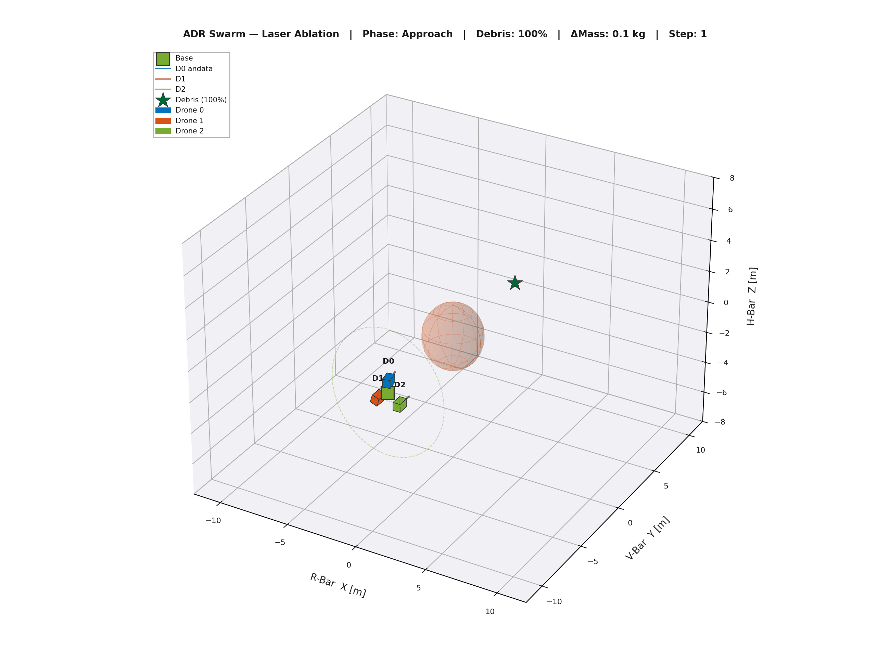
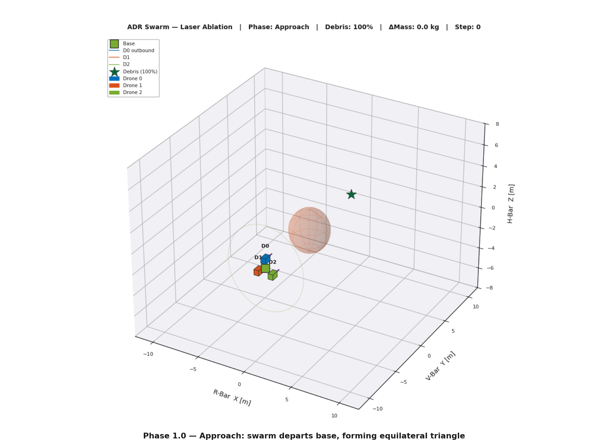
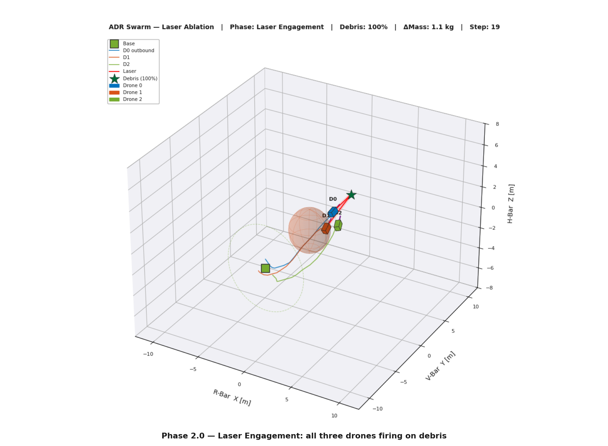
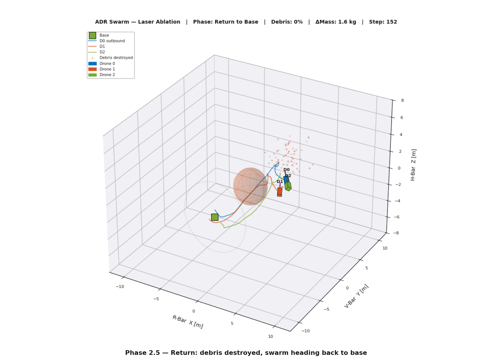
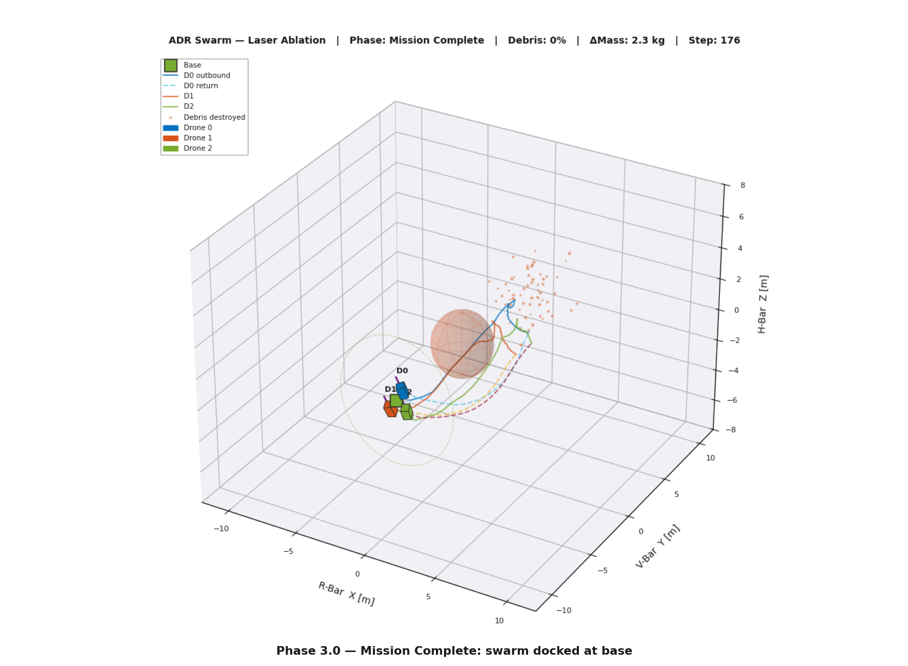
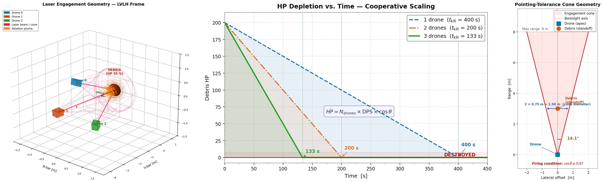

# Swarm Laser Debris Removal

**Cooperative Multi-Agent Deep Reinforcement Learning for Autonomous Laser-Based Active Debris Removal**

A three-drone swarm trained end-to-end with cooperative deep RL to laser-ablate a piece of LEO space debris and return to base, under full 6-DOF orbital physics.

<p align="center"></p>

## The mission

Three CubeSat-class chasers leave a base, converge into an equilateral triangle around the debris, fire their lasers together inside a shared pointing-tolerance cone until the target is destroyed, and fly back. One shared policy controls all three drones.

| Initial state | Laser engagement | Debris destroyed | Back at base |
|:---:|:---:|:---:|:---:|
|  |  |  |  |

## Approach

| | |
|---|---|
| **Algorithm** | Independent PPO (IPPO) with full parameter sharing, trained via fictitious self-play with a rotating trainee |
| **Simulator** | Custom Python 6-DOF Keplerian simulator (ECI/LVLH, rigid-body Euler dynamics), PettingZoo `ParallelEnv` |
| **Observation** | 28-D per-agent Dec-POMDP observation: goal error, obstacle positions, attitude, angular velocity, mission phase |
| **Attitude sensing** | Simulated star tracker built on Skyfield, the JPL DE421 ephemeris and the Hipparcos catalog |
| **Action space** | `MultiDiscrete([3]*6)` bang-bang thruster/torque commands (729 combinations), phase-dependent force magnitude |
| **Reward** | Dense navigation, fuel, pointing, damping, artificial-potential-field and formation terms, plus sparse milestone bonuses at phase transitions |

Laser damage scales with the cosine of the pointing error and adds up across drones, so each extra drone in the formation shortens the time to destroy the target almost linearly.

<p align="center"></p>

## Results

| Metric | Value |
|---|---|
| Training steps to convergence | ≈ 20 M (successive runs of `swarm.py`, resumed from the latest checkpoint) |
| Mean episodic reward | +197 (from a +34 baseline) |
| Steps to complete the 3-phase mission | 179 |
| Propellant used vs. available budget | 97.9 % efficiency |

Fixing one physical actuation-drift mismatch took the policy from 0 % mission completions to a fully converged mission. The converged policy completes the mission every time with near-deterministic, low-entropy behavior.

## Repository layout

```
Code/
  swarm.py                  environment (ADRSwarmEnv, StarTrackerModel), training loop and test rollout
  save_mission_frames.py    renders the four mission frames from a trained policy
  plot_laser_ablation.py    laser-ablation model figures
  requirements.txt          Python dependencies
Graphics/                   GIF and figures used above
```

## Running it

```bash
cd Code && pip install -r requirements.txt && python swarm.py   # trains 4 rounds x 2.5 M steps, then renders swarm_mission.gif

python plot_laser_ablation.py   # (from Code/) regenerates the laser-ablation figures, no training needed
python save_mission_frames.py   # (from Code/) renders the four mission frames from the trained policy
```

Checkpoints are written to `Code/swarm_checkpoints/` (not versioned). On the first run Skyfield downloads `de421.bsp` and the Hipparcos catalog. `save_mission_frames.py` needs a trained `swarm_checkpoints/swarm_shared_latest.zip`.

## Context

Sapienza University of Rome, 2026.

**Author:** Federico Falconi · [LinkedIn](https://www.linkedin.com/in/federico-falconi/)
